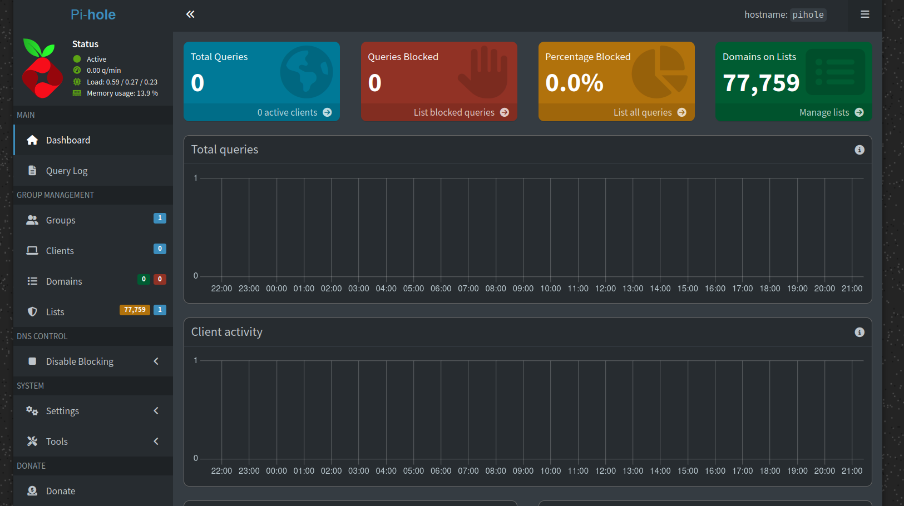
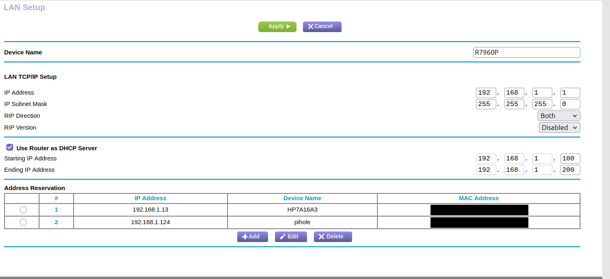
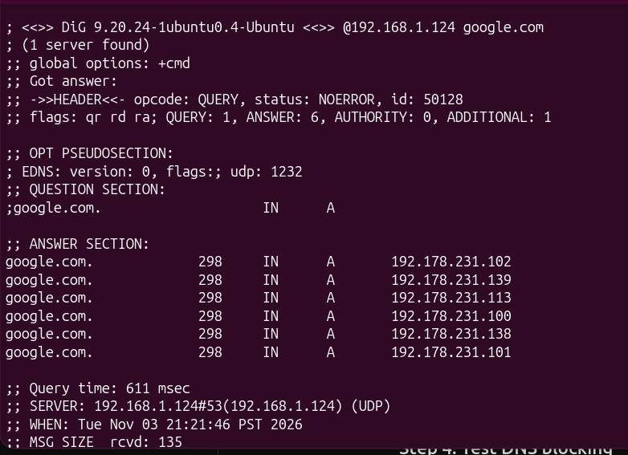
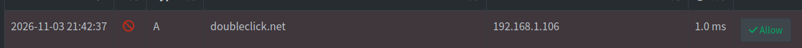
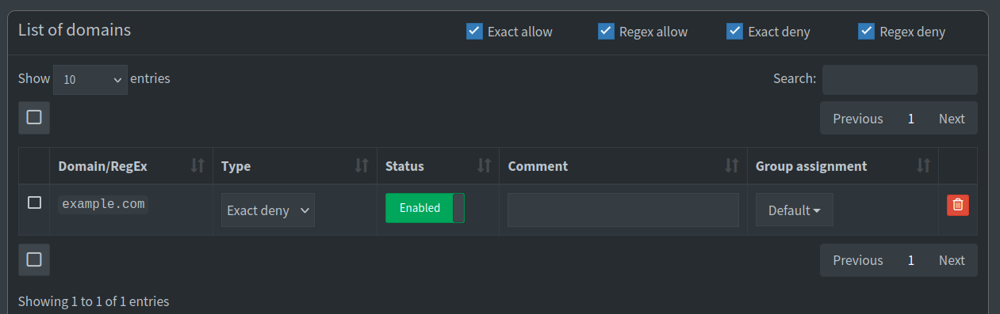
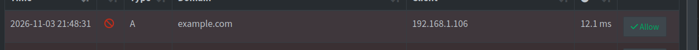

# Raspberry Pi Network Security Homelab

## Overview

This project documents my experience deploying Pi-hole DNS filtering and configuring WireGuard VPN on a Raspberry Pi to gain hands-on experience with network security, Linux administration, and troubleshooting.

The goal was to understand how network services work together and how DNS filtering and encrypted remote access can improve the security of a home network.

## Technologies Used

- Raspberry Pi Zero W
- Raspberry Pi OS 13 (Trixie)
- Pi-hole
- WireGuard
- DNS
- DHCP
- SSH
- Firewall rules
- Git and GitHub

## Project Objectives

1. Deploy Pi-hole for network-wide DNS filtering.
2. Configure router-level DNS settings to direct requests to Pi-hole.
3. Monitor allowed and blocked DNS queries.
4. Configure WireGuard for encrypted remote access.
5. Troubleshoot connectivity and DNS resolution problems.
6. Document implementation steps and lessons learned.

## Network Architecture

```text
Home Network Devices
        |
        v
    Home Router
   192.168.1.1
        |
        | DNS Forwarding
        v
     Pi-hole
  192.168.1.124
        |
   DNS Filtering
        |
   +----+----+
   |         |
Blocked   Allowed
             |
             v
       Upstream DNS
```

The Netgear router handles DHCP and forwards DNS queries to Pi-hole. Pi-hole checks requested domains against its configured filtering rules before allowing or blocking DNS resolution.

## Implementation

### Pi-hole DNS Filtering

Deployed Pi-hole on a Raspberry Pi Zero W and configured the home network to use it as a DNS filtering service.

Pi-hole evaluates domain requests against configured blocklists and prevents blocked domains from resolving normally.

### DNS Monitoring

Used the Pi-hole dashboard to examine DNS requests, blocked domains, and device activity.

### WireGuard VPN

Configured WireGuard to explore encrypted remote access and public-key authentication.

### Troubleshooting

Investigated DNS configuration and network connectivity issues while integrating the Raspberry Pi with the home router.

One challenge I encountered was accidentally disabling DHCP on my Netgear router, which prevented connected devices from receiving IPv4 addresses.

I troubleshot the issue by checking my network configuration, restoring DHCP functionality, and configuring a DHCP reservation for the Raspberry Pi.

## Skills Demonstrated

- DNS configuration and troubleshooting
- Linux system administration
- Network security monitoring
- DHCP configuration
- VPN fundamentals
- Firewall configuration
- Technical documentation

## Lessons Learned

This project helped me understand DNS resolution beyond classroom explanations. I gained practical experience configuring network services and troubleshooting connectivity issues.

It also reinforced the importance of validating network changes because incorrect DNS or routing configurations can disrupt connectivity for multiple devices.

One of my biggest takeaways was understanding the difference between DNS and DHCP and how both services work together to provide network connectivity.

## Future Improvements

- Add service availability monitoring.
- Test additional DNS filtering rules and document their effectiveness.
- Evaluate additional blocklists.
- Improve network security documentation.
- Explore redundant DNS configurations.

## Security Notice

This repository is intended for educational and portfolio purposes. Private IP addresses, VPN private keys, authentication credentials, and other sensitive configuration details should be removed or replaced with placeholders before publishing.

## Implementation Evidence

### Pi-hole Dashboard



The Pi-hole dashboard confirms that the DNS filtering service was active and that the configured domain lists contained 77,759 entries.

At the time of this screenshot, the dashboard displayed zero recorded queries and zero blocked queries. Later testing confirmed successful DNS resolution and filtering.

### DHCP Reservation



Configured a DHCP reservation on the Netgear R7960P router to assign the Raspberry Pi a consistent local IP address of `192.168.1.124`.

The router remains responsible for assigning IP addresses to devices on the home network.

### DNS Resolution Testing



Used the `dig` utility on Ubuntu to test DNS resolution directly against Pi-hole.

**Command:**

```bash
dig @192.168.1.124 google.com
```

The query returned a `NOERROR` response with six IPv4 addresses, confirming that the Raspberry Pi successfully responded to the DNS request.

### DNS Query Logging



Reviewed Pi-hole's query log to inspect DNS activity from a connected client.

The log recorded a request for `doubleclick.net` from `192.168.1.106`.

The query was allowed, demonstrating DNS query visibility but not successful domain blocking.

I later performed a controlled DNS-blocking test using a custom denylist rule.

### Custom Domain Denylist



Configured an exact denylist entry for `example.com` in the Pi-hole dashboard.

The rule was enabled for the Default group to test whether Pi-hole could block a manually specified domain.

### DNS Blocking Verification



After configuring the denylist, I generated another DNS request for `example.com` and reviewed the Pi-hole Query Log.

The request appeared with a blocked status, confirming that Pi-hole successfully applied the custom filtering rule.

This test demonstrated how DNS filtering policies can be configured and validated through query monitoring.

## Testing Summary

| Test | Expected Result | Observed Result |
|---|---|---|
| Pi-hole installation | DNS service running | Passed |
| DHCP reservation | Consistent Raspberry Pi IP | Reservation configured |
| DNS resolution | Successful domain resolution | Passed |
| DNS query logging | Queries appear in dashboard | Passed |
| Custom denylist | Domain added and enabled | Passed |
| DNS blocking | Denied domain is blocked | Passed |

## Documentation

Additional technical documentation is available in the `docs/` directory.

- [Project Overview](docs/01-project-overview.md)
- [Network Architecture](docs/02-network-architecture.md)
- [Pi-hole Installation](docs/03-pihole-installation.md)
- [WireGuard Configuration](docs/04-wireguard-configuration.md)
- [Testing and Validation](docs/05-testing-validation.md)
- [Troubleshooting](docs/06-troubleshooting.md)
- [Lessons Learned](docs/07-lessons-learned.md)