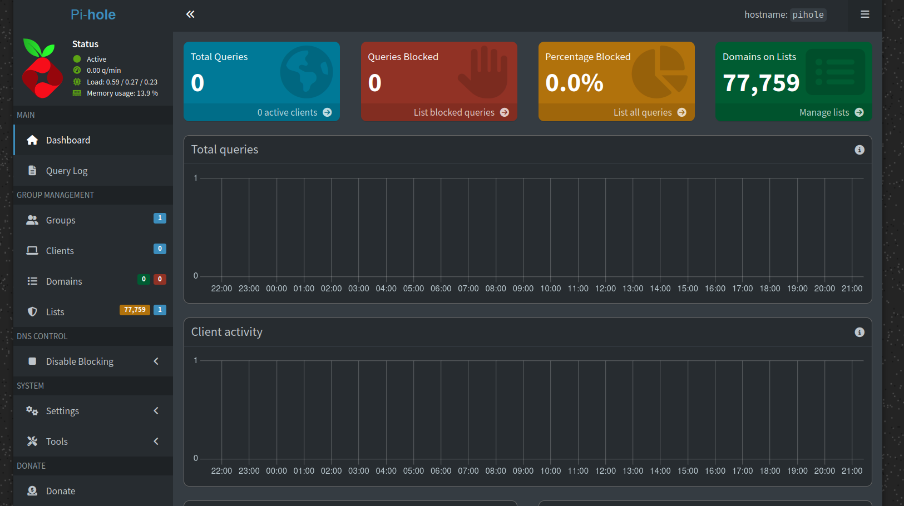
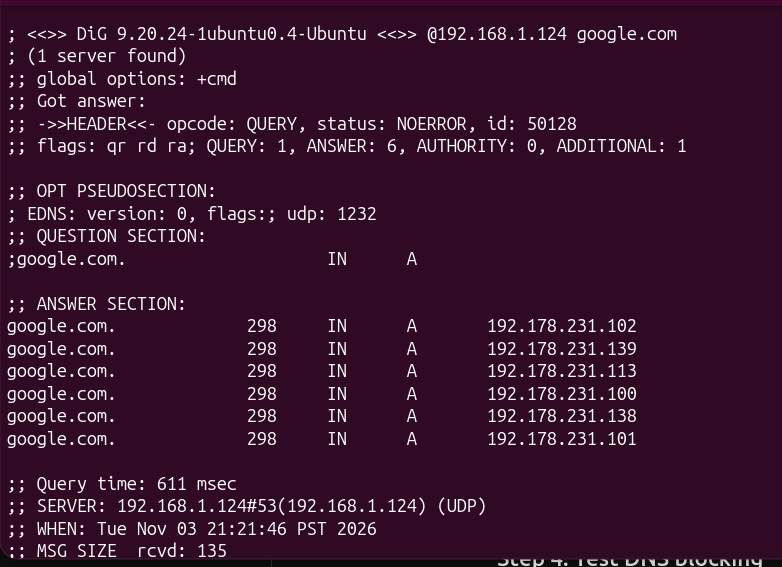
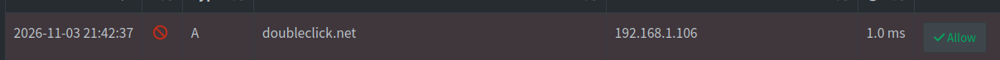
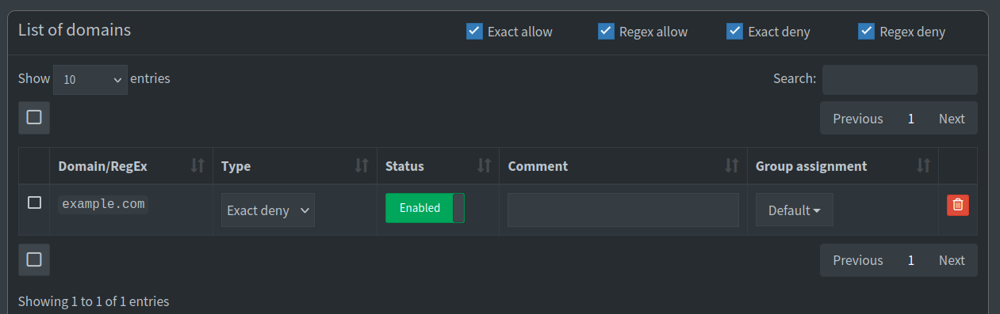

# Pi-hole Installation and Configuration

## 1. Overview

This document describes how I installed and configured Pi-hole on my Raspberry Pi Zero W.

The goal was to deploy a DNS filtering service on my home network, configure the Raspberry Pi with a consistent IP address, and verify that DNS resolution and blocking worked correctly.

Pi-hole was deployed on Raspberry Pi OS 13 (Trixie), with the Netgear R7960P router providing DHCP services.

## 2. System Information

| Component | Configuration |
|---|---|
| Hardware | Raspberry Pi Zero W Rev 1.1 |
| Operating System | Raspberry Pi OS 13 (Trixie) |
| Network Interface | `wlan0` |
| Raspberry Pi IP | `192.168.1.124` |
| Router IP | `192.168.1.1` |
| Subnet | `192.168.1.0/24` |
| DNS Filtering Software | Pi-hole |
| Remote Administration | SSH |

## 3. Raspberry Pi Preparation

I used Raspberry Pi Imager to install Raspberry Pi OS onto a microSD card.

After booting the Raspberry Pi, I connected to it remotely using SSH.

```bash
ssh hcpark@192.168.1.124
```

### Verify Operating System

```bash
cat /etc/os-release
```

The system reported Raspberry Pi OS based on Debian 13 (Trixie).

### Verify Network Configuration

```bash
hostname -I
ip -br addr
ip route
```

These commands helped identify the Raspberry Pi's assigned IP address, active network interface, and default gateway.

### Verify System Resources

```bash
free -h
df -h /
```

The Raspberry Pi Zero W has limited hardware resources, so I checked memory and storage availability before installing additional services.

## 4. System Updates

Before installing Pi-hole, I updated the operating system packages.

```bash
sudo apt update
sudo apt upgrade -y
```

This helped ensure that installed packages were up to date.

## 5. DHCP Reservation

Before deploying Pi-hole across the network, I configured a DHCP reservation on the Netgear R7960P router.

### Router Configuration

| Setting | Value |
|---|---|
| Router IP | `192.168.1.1` |
| DHCP Server | Enabled |
| DHCP Range | `192.168.1.100–192.168.1.200` |
| Raspberry Pi Reservation | `192.168.1.124` |

The reservation associates the Raspberry Pi's network interface with a consistent IP address.

This is important because devices must be able to reliably locate their DNS server.

### Verification

On the Raspberry Pi:

```bash
hostname -I
```

The Raspberry Pi reported:

```text
192.168.1.124
```

## 6. Pi-hole Installation

I installed Pi-hole using its official installation script.

```bash
curl -sSL https://install.pi-hole.net | bash
```

During installation, I configured the Raspberry Pi to provide DNS filtering through its network interface.

The installation included configuring upstream DNS resolution and enabling the Pi-hole web administration interface.

### Installation Components

Pi-hole provides:

- DNS filtering
- Domain blocklists
- DNS query logging
- Web administration dashboard
- Custom allowlist and denylist rules

## 7. Pi-hole Service Verification

After installation, I checked the Pi-hole service.

```bash
sudo systemctl status pihole-FTL
```

The `pihole-FTL` service provides DNS resolution, filtering, query statistics, and the web interface's supporting services.

I accessed the Pi-hole dashboard through:

```text
http://192.168.1.124/admin/
```

### Dashboard Evidence



The dashboard showed 77,759 domains on the configured filtering lists.

At the time of the screenshot, the dashboard displayed zero recorded queries.

Later testing confirmed that DNS requests could be processed and filtered.

## 8. Router DNS Configuration

After verifying that Pi-hole was responding to DNS requests, I configured my Netgear router's upstream DNS settings.

Under the router's Internet Setup settings, I selected the option to manually specify DNS servers.

I configured:

```text
Primary DNS: 192.168.1.124
```

The router continued handling DHCP.

This configuration allowed the router to forward DNS queries to Pi-hole.

### Network Flow

```text
Client Device
     |
     v
Netgear Router
192.168.1.1
     |
     v
Pi-hole
192.168.1.124
     |
     v
Upstream DNS
```

## 9. DNS Resolution Testing

I used the `dig` utility on my Ubuntu laptop to test DNS resolution directly against Pi-hole.

### Test Command

```bash
dig @192.168.1.124 google.com
```

### Expected Result

The DNS query should return a successful response containing one or more IP addresses.

### Observed Result

The query returned:

```text
status: NOERROR
```

The response included six IPv4 addresses.

This confirmed that Pi-hole was responding to DNS requests and successfully resolving the requested domain.

### Screenshot



## 10. DNS Query Monitoring

I accessed Pi-hole's Query Log to review DNS activity.

The log displayed information including:

- Requested domains
- Client IP addresses
- DNS query types
- Allowed or blocked status

### Screenshot



One recorded query involved:

```text
Domain: doubleclick.net
Client: 192.168.1.106
```

This demonstrated that Pi-hole was receiving DNS requests and recording activity from connected devices.

## 11. Custom Domain Blocking

To verify DNS filtering, I created a custom exact-deny rule.

### Test Domain

```text
example.com
```

I added the domain to Pi-hole's denylist and enabled the rule for the Default group.

### Screenshot



This provided a controlled test to determine whether Pi-hole would block a domain based on a manually configured rule.

## 12. DNS Blocking Verification

After configuring the denylist, I generated a DNS request for the test domain.

```bash
dig @192.168.1.124 example.com
```

I then reviewed the Pi-hole Query Log.

### Screenshot


The query was displayed with a blocked status.

This confirmed that Pi-hole successfully applied the custom denylist rule.

### Result

The DNS filtering test was successful.

The project demonstrated:

1. Successful DNS resolution.
2. DNS query logging.
3. Custom denylist configuration.
4. Successful DNS blocking.

## 13. Troubleshooting

### DHCP Configuration Issue

During router configuration, I accidentally disabled the Netgear router's DHCP server.

As a result, my Ubuntu laptop remained connected to Wi-Fi but did not receive an IPv4 address or default route.

I investigated the issue using:

```bash
ip -br addr
ip route
```

After identifying the problem, I restored DHCP functionality and configured a DHCP reservation for the Raspberry Pi.

This restored normal IP address assignment.

### Lessons Learned

This issue helped reinforce the distinction between DNS and DHCP.

DNS resolves domain names into IP addresses, while DHCP assigns network configuration information to connected devices.

## 14. Security Considerations

Pi-hole provides DNS-level filtering but does not replace other security controls.

Important considerations include:

- Pi-hole cannot detect every malicious domain.
- Applications using alternative DNS resolvers may bypass Pi-hole.
- DNS filtering does not inspect downloaded files for malware.
- Pi-hole availability affects DNS resolution for devices that depend on it.
- The administration dashboard should not be publicly exposed.

## 15. Conclusion

Installing Pi-hole on my Raspberry Pi Zero W gave me practical experience with DNS resolution, DHCP configuration, Linux administration, and network troubleshooting.

By configuring the router, testing DNS resolution, monitoring queries, and validating custom blocking rules, I was able to better understand how DNS filtering works in a real network environment.

The project also reinforced the importance of testing network changes and documenting troubleshooting steps.